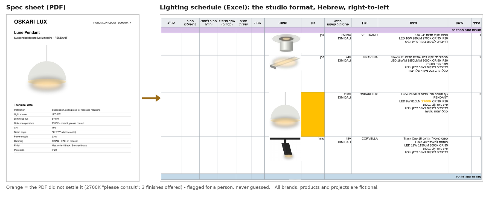
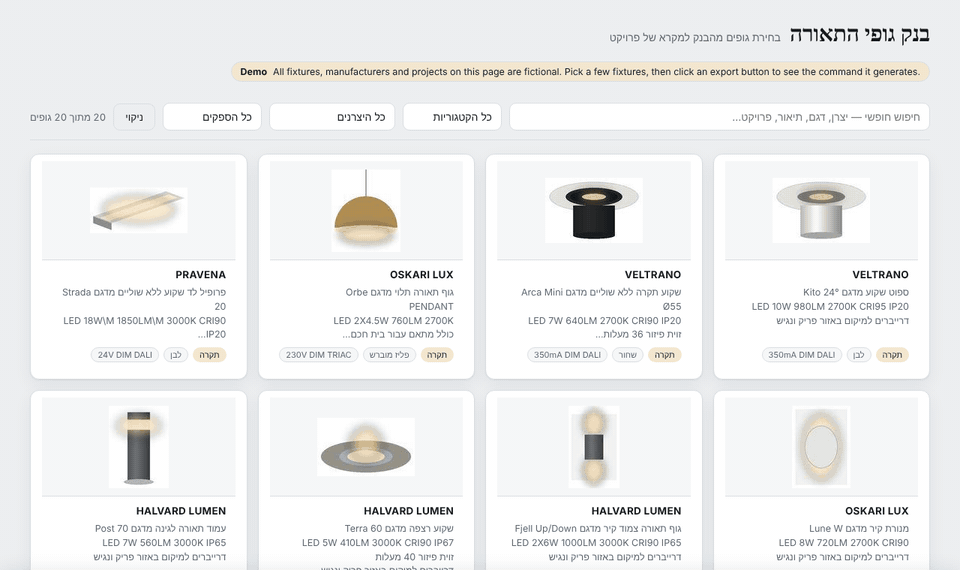
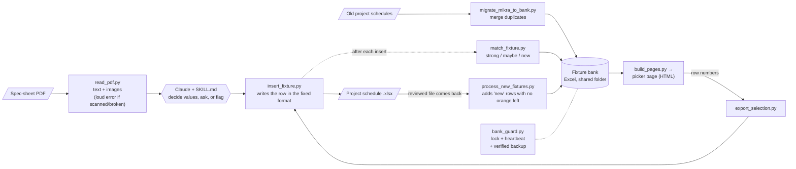

<h1 align="center">Lighting Schedule Automation</h1>

<p align="center">
  <b>Turns manufacturer spec-sheet PDFs and a bank of past fixtures into a lighting schedule in the studio's fixed Excel format,</b><br/>
  for an architectural lighting design studio. An LLM reads the PDF; deterministic Python writes the file.<br/>
  Anything the PDF doesn't settle is flagged orange for a person. Nothing is guessed.
</p>

<p align="center">
  <a href="https://guyavron.github.io/lighting-schedule-automation/"><b>🔗 Live demo: the fixture picker</b></a> ·
  
  
  
  
</p>

<p align="center">
  
  <br/><sub>A spec sheet becomes a row in the schedule. The PDF says "2700K, other K please consult" and lists three finishes, so those two values are flagged instead of picked.</sub>
</p>

<p align="center">
  
  <br/><sub>The picker page: search and filter the bank, pick fixtures, get the export command. <b>All data in this repository is fictional</b>: invented brands, products and projects, and product images drawn in code.</sub>
</p>

---

## The problem

A **lighting schedule** (in Hebrew, *mikra*) is the table of every light fixture in a project: what it is, who makes it, voltage and dimming, finish, a product photo, quantities and prices. The studio writes it in a **fixed Excel format**: Hebrew, right-to-left, three category blocks (ceiling / wall / floor), merged headers and colour bars.

Before this project, each schedule was built by hand:

- **Re-typing from PDFs.** For each fixture, someone opens the manufacturer's spec sheet and copies the values into the right cells, in the studio's own writing style.
- **Searching old projects.** The same fixtures come back project after project, but the only way to reuse one was to find it in an old Excel file and copy it over.
- **About 1–4 hours per schedule** by my own estimate (it depends on the project: a flat vs. an office building), plus corrections as the project moves on.

The constraint that shaped everything: **a wrong value in a schedule is worse than an empty cell.** A schedule goes to clients and contractors, and an invented beam angle or finish looks exactly like a real one.

## What it does

- **PDF → schedule row.** A Claude skill reads the spec sheet, writes the row in the studio's format, and **flags every value the PDF doesn't settle** (orange cell, or just the doubtful phrase in orange, with a comment). When a sheet offers options ("38° / 72°"), it asks, and it batches all questions from several PDFs into one round.
- **A fixture bank built from past projects.** Old schedules are merged into one filterable table. Duplicates across projects are combined, and every fixture remembers which projects it came from.
- **Pick from the bank → new schedule.** A static web page (search, filters that narrow each other, select by clicking) generates the export command. Python then builds the schedule in the exact format.
- **New fixtures flow back into the bank.** Every fixture added from a PDF is checked against the bank: *already there*, *maybe a duplicate* (a person decides), or *new*. When the reviewer sends the file back, new fixtures join the bank, **but only once nothing in the row is still orange.**
- **Safe in a shared folder.** A soft lock stops two people writing to the bank at once (cloud sync doesn't merge Excel files; it silently keeps one version). A heartbeat keeps the lock alive only while the run is, so a crash frees it in about two minutes. A rolling backup is taken before every change, and only if the bank opens as a valid file.
- **Works on an existing project too**, not only new ones: from the bank, or from a PDF.

## Architecture

The one rule: **the LLM decides, the code writes.** Reading a spec sheet takes judgment, because every manufacturer lays it out differently. Writing the Excel file has to be exactly the same every time.



| Folder | What's inside |
|---|---|
| [`skill/`](skill) | `SKILL.md`: the instructions Claude follows (the "no hallucination" rules, when to ask, the writing style); the three scripts it calls |
| [`bank/`](bank) | Bank scripts: import old schedules, match, export, add returned fixtures, lock & backup (`unlock_bank.py` releases a stuck lock). [`bank/migrations/`](bank/migrations) holds one-off data repairs |
| [`pages/`](pages) | The picker page: a template plus the script that embeds a snapshot of the bank in it |
| [`examples/`](examples) | Generators for **all** the fictional data: template, 3 old projects, spec sheets (including broken ones) |
| [`tests/`](tests) | 64 failure-mode tests |

## Key engineering decisions

| Decision | Why |
|---|---|
| **The LLM reads, Python writes** | Spec sheets vary too much for one parser, but the Excel layout (merged cells, colour bars, row heights, anchored photos) must be identical every time. Writing it from code means one tested path; letting the model "edit the spreadsheet" would mean a slightly different file each run. |
| **Flag, don't guess** | The studio's rule: an invented value is worse than an empty cell. The model passes uncertain fields to the script, which marks them orange with a comment. An empty field is now flagged by the script itself, so leaving a field out can't skip it silently. |
| **Columns found by their header text, never by letter** | Real project files add, remove and rename columns. Every script reads the actual header row and leaves unknown columns (quantities, prices) untouched. |
| **The picker page only selects; it never writes the schedule** | A web page can't produce the studio's Excel format reliably. The page outputs row numbers, and the same `insert_fixture()` used for PDFs builds the file. The page holds a snapshot of the bank, so it opens in any browser with no account or server. |
| **Returning the reviewed file is the approval**, except for orange rows | No extra chat round to confirm new fixtures, but a value nobody confirmed must not spread into every future project through the shared bank. |
| **Lock + backup, write-only** | Two people writing the bank at once loses one update silently. The lock and backups only ever create or overwrite files, so they work in folders without delete permission. |
| **Every file is saved to a temp file, then swapped in** | A crash or a file open in Excel can't leave a half-written schedule or bank. The original stays untouched. |

## Challenges & how I solved them

**1. "It works" is not "it fails safely": a failure-focused QA pass**

I wrote tests for the inputs that go wrong in real life: a scanned PDF, a truncated download, a "PDF" that's really a saved web page, a workbook that's open in Excel, a corrupt file, two runs at once, the same file returned twice. Then I reproduced each finding on the original code before fixing it. The ones that mattered:

| Symptom | Diagnosis | Fix |
|---|---|---|
| A **scanned PDF** "succeeded" with empty text | `pdftotext` returns nothing for an image-only page, without an error. An empty extraction is exactly when values get invented | Distinct exit codes (missing / not a PDF / damaged / **no text layer**). For a scan, every field read from the image must be flagged |
| The **first fixture of a new schedule never reached the bank** | The script printed its row number *before* deleting the template's example row above it. The "new fixture" note then landed on the next category's header | Report the final row. A test checks the note lands on the fixture |
| A new floodlight was reported as **"already in the bank"** (score 0.82 vs. an in-ground light) | The duplicate key ran past the model name into the LED spec line, which looks alike in every fixture | Compare model names only (stop at the spec line). Different products of one brand now come back as "maybe": a person checks, nothing is lost |
| The orange highlight on a single phrase **disappeared** | A later script re-saved the file without rich text, which flattens it | Open every workbook with rich text kept |
| Confirmed values in a new row **turned orange** | A new row copied its style from the flagged row above it | Copy borders and fonts, not the orange fill |
| Line breaks were **flattened** in the bank | A whitespace clean-up meant for comparisons was also used for storage | Separate "compare" and "store" clean-ups. Rows already imported were repaired by a one-off migration ([`restore_line_breaks.py`](bank/migrations/restore_line_breaks.py)): it takes the line-broken text from the old schedules, only when exactly one version exists, and checks per cell that not a single word changed (436 cells in the real bank) |

**2. A second pass: using it like a new employee.**

After the first fixes I went through the tool as someone on their first week would: two projects at once, killing a run halfway (`kill -9`), a damaged bank, sorting the bank in Excel, a schedule left open in Excel, odd project names. Each finding was reproduced first, then fixed, then locked in by a test (the new tests fail on the old code).

| Symptom | Diagnosis | Fix |
|---|---|---|
| Two projects that returned the **same new fixture** put it in the bank twice (a re-run after a crash did too) | Each reviewer was told "new" against the bank as it was *then* | Before adding, every fixture is matched again against the *current* bank. "Strong" means skip it |
| A damaged bank plus five failed runs **overwrote all five backups** with damaged copies | The backup copied whatever file was there | The bank must open as a valid `.xlsx` first; otherwise a warning and the backups stay as they are |
| After a crash the bank stayed **locked for 10 minutes** | A fixed expiry, because a crashed run can't unlock anything | A heartbeat refreshes the lock every 15 s, so without one it expires after 120 s. `unlock_bank.py` releases it by hand; the state file is written atomically |
| An **old picker page** exported the wrong fixture after the bank was sorted | The page remembered row numbers, and row 31 was now a different fixture | Every fixture carries a 4-character fingerprint. The command says `31:8e7c`, and the export stops if row 31 no longer matches |
| A `/` in a project name **created a folder** | The name went straight into the file name | Characters Windows doesn't allow become `-`, and the change is printed |
| A real description starting with `[Ø55]` was **deleted** as the template's example row | The example row was recognised by "starts with `[`" | It is recognised by its fixed placeholder text |
| The schedule was open in Excel when the run finished: the bank **was** already updated, the message said nothing happened | The bank is written first, the schedule second | The message says so, and a re-run recognises the fixtures and only updates the note |
| Every new fixture from a known manufacturer came back "maybe" (so **none was ever added**) | On the real bank they scored 0.51 to 0.55, because the brand name alone is worth about 0.25. Truly similar ones scored 0.71 to 0.79 | "Maybe" threshold raised from 0.45 to 0.60, in the gap between the two groups |
| `Nexa 35` vs `Nexa 50` came back "maybe" | A different number in the model name usually means a different product, but the names look alike letter by letter | A model-number rule: two lists of numbers where neither contains the other cap the score at "new". `Orbo Floor 2` vs `Orbo Floor 2 F7741020` stays "maybe": same product, extra part number |

**3. Duplicates are a judgment call, so the code shows it instead of hiding it.**
The same fixture is written differently across years: the real bank has manufacturer names spelled two or three ways (`PRAVENA` / `PRAVENNA` in the demo). The import step merges only exact model keys and **prints every merge**. The live check gives three verdicts, and "maybe" always goes to a person. I deliberately didn't tune the thresholds on made-up data. The first cut-off (0.45) was a guess, and the real bank showed it was too low: it sent every new fixture to a person. It is now 0.60, set from the gap between real "new" and real "similar" scores. The tests reproduce that gap with invented products.

**4. The photo that wasn't a photo.**
In the first version, the "largest image in the PDF" was picked as the product photo, and twice it was a photometric diagram. Since then, the model looks at the page images and chooses, and a separate review page (an internal tool, not in this repo) lets a person mark bad photos in the bank. A high text-match score doesn't mean a good image, so a person picks the replacement.

## Results

- **266 fixtures in the real bank**, merged from **37 of the 91** old project files that were fed in (the other 54 were full duplicates or had a different layout).
- The PDF → row flow was checked end-to-end on **8 real spec sheets from 5 manufacturers**.
- **Status, honestly:** the studio's team is starting to use it gradually this week. So there's **no measured time saving yet**; the 1–4 hours above is the manual baseline it's meant to cut.
- For a team that doesn't use AI tools, I also made a **2.5-minute training video** (desktop and phone versions) showing the three paths: from the bank, adding to an existing project, and a new fixture from a PDF.
- This repository: `python demo.py` runs the whole flow on fictional data in about 20 seconds; `python -m unittest discover -s tests` runs 64 failure-mode tests.

## How I built it

I built this with an **AI-assisted workflow**: Claude wrote most of the code, and Claude is also the runtime for the skill. My part:

- **Defined the problem with the studio**: what a schedule must contain, the writing style of the description field (confirmed field by field), what counts as a duplicate, what must never be automated
- **Set the rules the system runs on**: flag instead of guess, ask when a sheet offers options, one row per fixture, the returned file is the approval
- **Made the architecture calls**: LLM reads / code writes; a static picker page instead of a live connector; Excel in a shared folder (with lock + backup) instead of a database the team would need to learn
- **Tested on real files** (old projects and spec sheets), and ran the failure-focused QA pass above
- **Planned the handover**: install guide, training video, and making sure nothing depends on me personally

## Known limitations

- **The review step still depends on row numbers.** The picker page is protected by row fingerprints, but `apply_images --map` (replacing product photos from a review page) takes plain bank row numbers. If the bank is sorted between building that page and applying the map, a photo can land on the wrong fixture. Until it gets fingerprints too: don't sort the bank while a review is open.
- **OneDrive AutoSave can write to a file that is open in Excel.** The tool saves to a temp file and swaps it in, so a file locked by Excel is left untouched with a clear message. But with AutoSave on, Excel can sync its own changes to the same file at the same moment. Close the schedule (and the bank) while the tool runs, or turn AutoSave off for them.
- **A hard crash can leave one `.~saving-<name>` file** next to the target. It is harmless, ignored by git, and overwritten by the next save of that file.

## Limitations & next steps

- **Duplicate detection is heuristic.** Brand names that merely look alike can still pass the "same brand" gate: two unrelated invented brands, `SOLVIK LUCE` and `HALVARD LUMEN`, scored exactly the 0.5 cut-off in testing. The "maybe" threshold was calibrated once, on one bank of 266 fixtures. A fixture with the same model but worded differently still lands in "maybe" (safe: a person decides). Next: keep calibrating on the "maybe" cases the team resolves.
- **The LLM step can't run offline.** `demo.py` replays recorded decisions ([`claude_decisions.json`](examples/data/claude_decisions.json)); the reading itself needs Claude.
- **The picker page is a snapshot**, rebuilt automatically after each bank change. Opening it inside Claude needs a re-publish.
- **Excel as the database** is a choice for the team, not for scale. Past a few thousand fixtures, or with several heavy users, a real database becomes worth it.
- **Next:** measure the real time per schedule now that the team is starting, and run the tests in CI on every push.

## Tech stack

| Layer | Technology |
|---|---|
| AI | Claude, as an Agent Skill (`SKILL.md` + scripts) |
| Excel | Python 3, openpyxl (rich text, merged cells, anchored images), Pillow |
| PDF | poppler (`pdftotext`, `pdftoppm`, `pdfimages`) |
| Picker page | Static HTML/CSS/JS, data embedded at build time, GitHub Pages |
| Demo data | reportlab (spec sheets), Pillow (product images drawn in code) |
| Tests | `unittest`, run against generated broken files |

## Run locally

```bash
git clone https://github.com/guyavron/lighting-schedule-automation.git
cd lighting-schedule-automation
pip install -r requirements.txt     # also needs poppler-utils (pdftotext) on PATH
python demo.py                      # writes everything to examples/out/
python -m unittest discover -s tests -v
```

Then open `examples/out/מקרא - דירת דמו.xlsx` in Excel and `examples/out/picker.html` in a browser.
Ready-made outputs are also in [`docs/sample-output/`](docs/sample-output).

---

<p align="center"><i>Built by <a href="https://github.com/guyavron">Guy Avron</a> · Industrial Engineering & Management, Ben-Gurion University</i></p>
